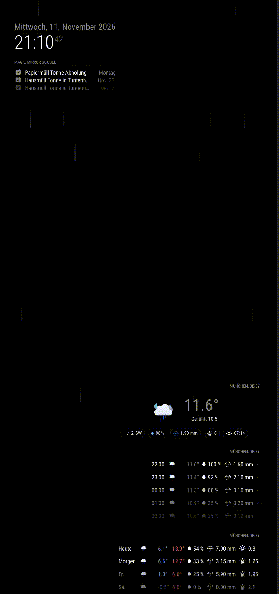

# MMM-FlyBy

MMM-FlyBy is a overlay module for MagicMirror² that brings your display to life. It animates custom floating images—from seasonal sprites like Santa Claus to kids' favorite cartoon characters—soaring across your screen with a gentle bobbing flight path, sparkles, and stars.

Easily configure your characters to appear at scheduled times or regular intervals, and utilize the optional nighttime quiet period to keep things distraction-free when needed.

## Demo
<p align="center">
  
</p>

## Installation

```bash
cd ~/MagicMirror/modules
git clone https://github.com/Thomas-Mildner/MMM-FlyBy
```

## Configuration

Add an entry to the `modules` array in `config/config.js`:

```js
  {
      module: "MMM-FlyBy",
      position: "fullscreen_above",
      config: {
        images: ["airplane.png", "ghost.png"],
        motionProfile: "gentle",
        firstDelay: 1000,
        interval: 10000,
        duration: 9000,
        showSparkles: false,
        showStars: true,
        nightHours: null
      }
    },
```

The module can be configured with these options:

| Option | Default | Description |
| --- | --- | --- |
| `image` | `"airplane.png"` | Image to display, located in the module's `images` directory. |
| `images` | `[]` | Optional list of image filenames. When non-empty, one is chosen at random for each flight, overriding `image` for that flight. |
| `size` | `160` | Image width in pixels. |
| `interval` | `300000` | Time between flights in milliseconds (5 minutes). |
| `firstDelay` | `5000` | Delay before the first flight in milliseconds. |
| `duration` | `12000` | Duration of each flight in milliseconds. |
| `minY` | `10` | Top of the flight-height range, as a percentage of the screen height. |
| `maxY` | `60` | Bottom of the flight-height range, as a percentage of the screen height. |
| `bob` | `25` | Vertical wave amount in pixels. |
| `motionProfile` | `"wave"` | Flight style: `"straight"` for no bob or rotation, `"gentle"` for a smaller one-cycle wave, or `"wave"` for the default two-cycle wave. |
| `showSparkles` | `true` | Show sparkles in the character's trail. |
| `showStars` | `false` | Show stars in the character's trail. |
| `randomDirection` | `true` | Randomly choose left-to-right or right-to-left. Set to `false` to always fly left-to-right. |
| `nightHours` | `[23, 6]` | Hours during which flights are suppressed, using the local 24-hour clock. `[23, 6]` suppresses flights from 23:00 until 06:00. Set to `null` to allow flights at all times. |

For example, to randomly use the included images and show stars:

```js
{
	module: "MMM-FlyBy",
	position: "fullscreen_above",
	config: {
		images: ["ghost.png"],
		showStars: true
	}
}
```

Custom images can also be added to the module's `images` directory and referenced by filename in `image` or `images`. Transparent PNG images work well for this animation.

## Releases

Releases and `CHANGELOG.md` are managed by [Release Please](https://github.com/googleapis/release-please). Push commits using the Conventional Commits format to `main`. Release Please opens a pull request with the version update and generated changelog; merging that pull request publishes the GitHub release.

- `feat: add configurable flight speed` creates a minor release.
- `fix: correct flight direction` creates a patch release.
- `feat!: change the configuration format` creates a major release for a breaking change.
